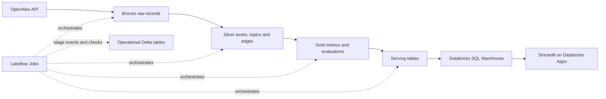

# Architecture

| Layer | Responsibility |
| --- | --- |
| Bronze | Preserve each current raw record as JSON with its ingestion time, normalized source ID and run identifier. Scope works to a corpus fingerprint. |
| Silver | Normalize and deduplicate works and topics. Preserve one primary topic, assigned topics with relevance, and directed cited publication IDs. |
| Gold | Materialize counts, indicators, and planned evaluation and network datasets. |
| Serving | Expose application-ready counts, series, rankings, contributions and related topics. |
| Operational | Track extraction progress, notebook lifecycle events and quality checks. |

Jobs express stage dependencies explicitly. Each notebook resolves the shared driver package and YAML config from workspace files and reads persistent Delta inputs. Setup creates managed Delta tables within an existing catalog. The app uses its service principal to query only Serving contracts.

Physical Bronze writes keep the latest payload per entity ID (and per corpus for works). Silver and downstream stages use atomic single-table refreshes. Operate one corpus configuration per target catalog/schema set and serialize different jobs writing the same tables. Job-level concurrency limits apply to each job independently. Cross-table snapshots and cross-job locking remain deployment decisions.
