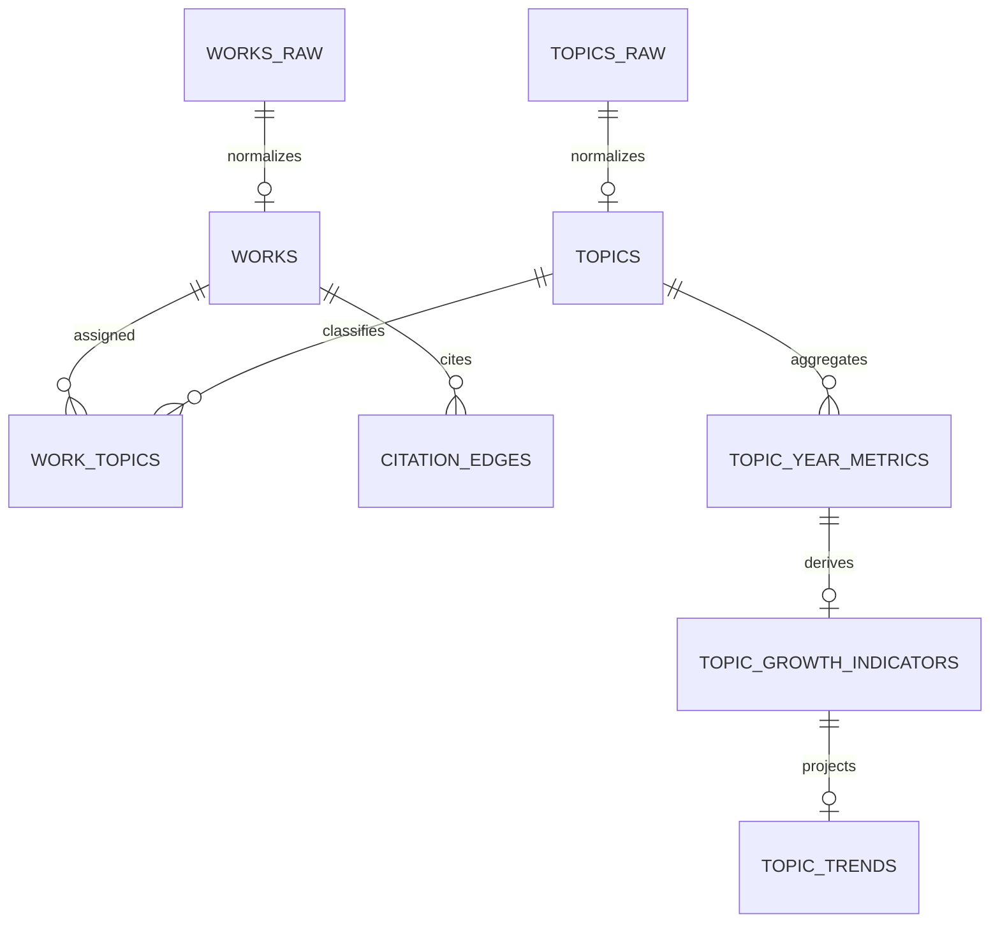

# Delta data model

All names are resolved as `catalog.schema.table`. Keys are logical uniqueness requirements. Delta DDL provides the column types.



## bronze.works_raw

Latest raw work JSON for the configured corpus.

- Logical key — corpus, source_id
- Producers — ingest_works
- Consumers — profile_raw_data, normalize_works, build_work_topics

```sql
source_id STRING, ingested_at TIMESTAMP, run_id STRING, payload STRING, corpus STRING
```

## bronze.topics_raw

Latest raw topic JSON.

- Logical key — source_id
- Producers — ingest_topics
- Consumers — profile_raw_data, normalize_topics

```sql
source_id STRING, ingested_at TIMESTAMP, run_id STRING, payload STRING
```

## silver.works

Normalized publications with current citation totals.

- Logical key — work_id
- Producers — normalize_works
- Consumers — build_work_topics, build_citation_edges, validate_silver, topic_year_metrics, field_year_metrics, topic_citation_network

```sql
work_id STRING, title STRING, publication_year INT, primary_topic_id STRING, cited_by_count BIGINT, referenced_works ARRAY<STRING>
```

## silver.topics

Topic taxonomy and parent hierarchy.

- Logical key — topic_id
- Producers — normalize_topics
- Consumers — validate_silver, topic_year_metrics, field_year_metrics, publish_topic_overview

```sql
topic_id STRING, topic_name STRING, subfield_id STRING, subfield_name STRING, field_id STRING, field_name STRING, domain_id STRING, domain_name STRING
```

## silver.work_topics

Assigned topics and relevance.

- Logical key — work_id, topic_id
- Producers — build_work_topics
- Consumers — validate_silver, topic_cooccurrence

```sql
work_id STRING, topic_id STRING, is_primary BOOLEAN, relevance DOUBLE
```

## silver.citation_edges

Directed references including external works.

- Logical key — citing_work_id, cited_work_id
- Producers — build_citation_edges
- Consumers — topic_citation_network

```sql
citing_work_id STRING, cited_work_id STRING, citing_year INT, cited_in_corpus BOOLEAN
```

## gold.topic_year_metrics

Annual primary-topic counts.

- Logical key — topic_id, publication_year
- Producers — topic_year_metrics
- Consumers — growth_indicators, historical_evaluation, publish_topic_overview

```sql
topic_id STRING, field_id STRING, publication_year INT, publication_count BIGINT
```

## gold.field_year_metrics

Annual field counts in the collected corpus.

- Logical key — field_id, publication_year
- Producers — field_year_metrics
- Consumers — growth_indicators, historical_evaluation

```sql
field_id STRING, publication_year INT, publication_count BIGINT
```

## gold.topic_growth_indicators

Trailing growth and relative prominence.

- Logical key — topic_id, publication_year
- Producers — growth_indicators
- Consumers — emergence_scores, temporal_analysis, indicator_comparison, publish_topic_trends, publish_rankings

```sql
topic_id STRING, field_id STRING, publication_year INT, publication_count BIGINT, absolute_growth BIGINT, relative_growth DOUBLE, cagr DOUBLE, acceleration DOUBLE, volatility DOUBLE, topic_share DOUBLE, share_change DOUBLE, field_adjusted_growth DOUBLE
```

## gold.topic_emergence_scores

Composite and individual score components.

- Logical key — topic_id, publication_year
- Producers — emergence_scores
- Consumers — indicator_comparison, publish_rankings

```sql
topic_id STRING, publication_year INT, composite_score DOUBLE, components MAP<STRING,DOUBLE>
```

## gold.indicator_comparison

Agreement among indicator rankings.

- Logical key — publication_year, indicator, baseline
- Producers — indicator_comparison
- Consumers — evaluation_summary

```sql
publication_year INT, indicator STRING, baseline STRING, spearman DOUBLE, top_k_overlap DOUBLE
```

## gold.historical_evaluation

Retrospective feature and outcome pairs.

- Logical key — cutoff_year, horizon, topic_id, indicator
- Producers — historical_evaluation
- Consumers — evaluation_summary

```sql
cutoff_year INT, horizon INT, topic_id STRING, indicator STRING, score DOUBLE, observed_growth DOUBLE, feature_max_year INT
```

## gold.evaluation_summary

Ranking performance by cutoff.

- Logical key — cutoff_year, horizon, indicator, k
- Producers — evaluation_summary
- Consumers — Analysts and operators

```sql
cutoff_year INT, horizon INT, indicator STRING, k INT, spearman DOUBLE, precision_at_k DOUBLE, top_k_overlap DOUBLE
```

## gold.topic_cooccurrence_edges

Undirected topic pairs ordered by ID.

- Logical key — source_topic_id, target_topic_id
- Producers — topic_cooccurrence
- Consumers — network_metrics, community_detection, publish_related_topics

```sql
source_topic_id STRING, target_topic_id STRING, weight BIGINT
```

## gold.topic_citation_edges

Directed edges between primary topics.

- Logical key — source_topic_id, target_topic_id
- Producers — topic_citation_network
- Consumers — network_metrics, community_detection, publish_related_topics

```sql
source_topic_id STRING, target_topic_id STRING, weight BIGINT
```

## gold.topic_network_metrics

Degree statistics by network.

- Logical key — network, topic_id
- Producers — network_metrics
- Consumers — community_detection

```sql
network STRING, topic_id STRING, degree BIGINT, weighted_degree DOUBLE
```

## gold.topic_communities

Community assignments by network.

- Logical key — network, topic_id
- Producers — community_detection
- Consumers — publish_related_topics

```sql
network STRING, topic_id STRING, community_id STRING
```

## serving.topic_overview

Corpus publication totals by topic.

- Logical key — topic_id
- Producers — publish_topic_overview
- Consumers — Databricks App

```sql
topic_id STRING, topic_name STRING, field_id STRING, field_name STRING, publication_count BIGINT
```

## serving.topic_trends

Topic time series.

- Logical key — topic_id, publication_year
- Producers — publish_topic_trends
- Consumers — Databricks App

```sql
topic_id STRING, field_id STRING, publication_year INT, publication_count BIGINT, relative_growth DOUBLE, topic_share DOUBLE
```

## serving.emerging_topics

Rankings for the app.

- Logical key — topic_id, publication_year, indicator
- Producers — publish_rankings
- Consumers — Databricks App

```sql
topic_id STRING, field_id STRING, publication_year INT, indicator STRING, score DOUBLE, rank BIGINT
```

## serving.indicator_explanations

Contributions to individual rankings.

- Logical key — topic_id, publication_year, indicator, component
- Producers — publish_rankings
- Consumers — Databricks App

```sql
topic_id STRING, publication_year INT, indicator STRING, component STRING, contribution DOUBLE
```

## serving.related_topics

Topic neighbors.

- Logical key — source_topic_id, target_topic_id, network
- Producers — publish_related_topics
- Consumers — Databricks App

```sql
source_topic_id STRING, target_topic_id STRING, network STRING, weight BIGINT
```

## ops.pipeline_runs

Stage lifecycle events.

- Logical key — run_id, stage, recorded_at
- Producers — All stages
- Consumers — Analysts and operators

```sql
run_id STRING, stage STRING, recorded_at TIMESTAMP, status STRING
```

## ops.ingestion_checkpoints

Latest cursor and record budget for one extraction.

- Logical key — stream_id, extraction_id
- Producers — ingest_topics, ingest_works
- Consumers — ingest_topics, ingest_works

```sql
stream_id STRING, extraction_id STRING, next_cursor STRING, records BIGINT, complete BOOLEAN, updated_at TIMESTAMP
```

## ops.data_quality_results

Recorded invariant and warning results.

- Logical key — run_id, stage, check_name, checked_at
- Producers — profile_raw_data, validate_silver, normalize_topics, normalize_works, build_work_topics, build_citation_edges, topic_year_metrics, field_year_metrics, growth_indicators, publish_topic_overview, publish_topic_trends
- Consumers — profile_raw_data, validate_silver

```sql
run_id STRING, stage STRING, check_name STRING, severity STRING, failures BIGINT, checked_at TIMESTAMP
```

## Relationships across analytical contracts

- Topic and field metrics join on `field_id, publication_year`; topic growth and emergence rows join on `topic_id, publication_year`.
- Historical feature and outcome rows use a cutoff and horizon rather than an annual ranking year. Summary rows group historical rows by cutoff, horizon and indicator.
- Both endpoint columns of topic-level graph edges reference `silver.topics.topic_id`. The cited endpoint of a Silver citation edge can be outside `silver.works`.
- Serving topic series and rankings reference the topic identifier from the taxonomy. Ranking explanations reference a ranking by topic, year and indicator.
- Operational run and quality events correlate by `run_id, stage`. Checkpoints identify extraction streams independently so a later job run can resume the same extraction.
