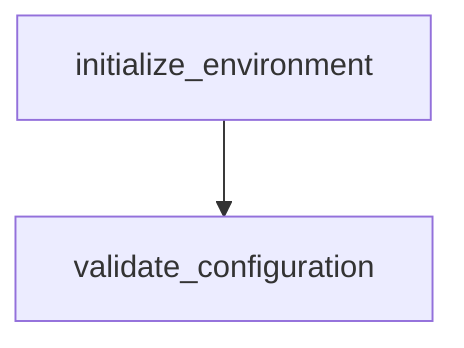
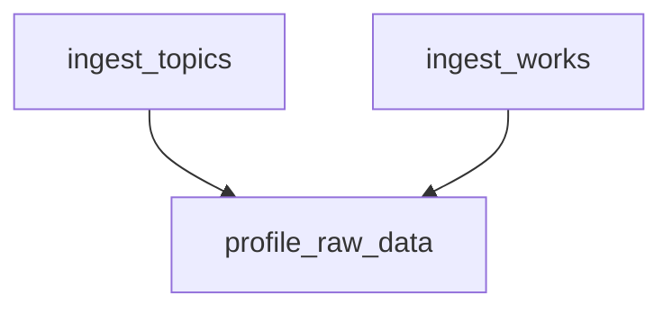
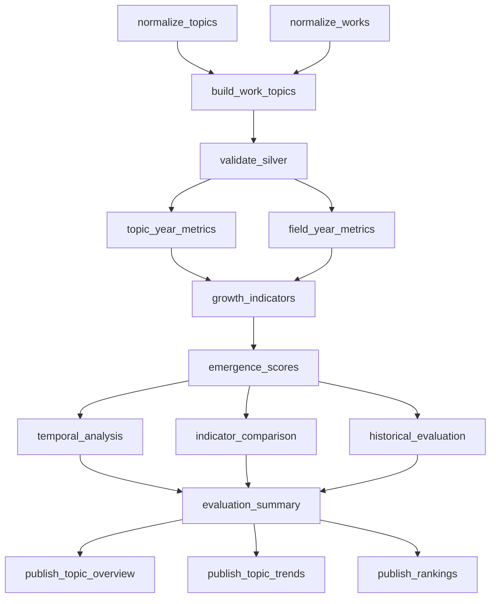
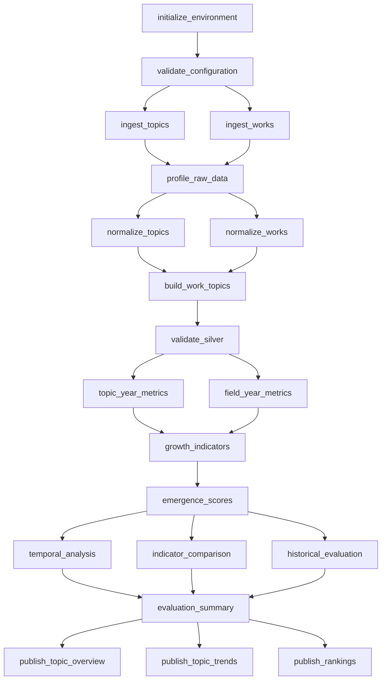
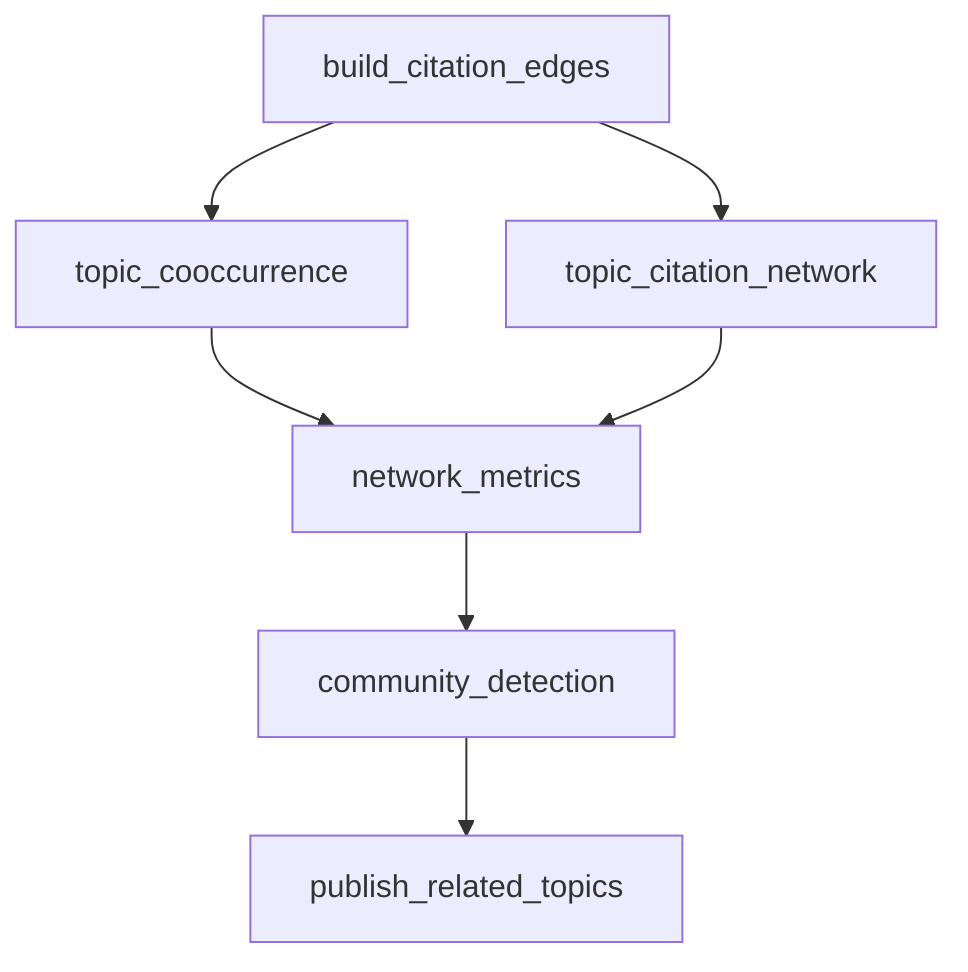

# Notebook contracts and workflows

| Stage | Inputs | Outputs |
| --- | --- | --- |
| [initialize_environment](../notebooks/00_setup/00_initialize_environment.py) | Configuration | All registered contracts |
| [validate_configuration](../notebooks/00_setup/01_validate_configuration.py) | Configuration | Execution summary |
| [ingest_topics](../notebooks/01_bronze/01_ingest_topics.py) | Configuration | bronze.topics_raw, ops.ingestion_checkpoints |
| [ingest_works](../notebooks/01_bronze/02_ingest_works.py) | Configuration | bronze.works_raw, ops.ingestion_checkpoints |
| [profile_raw_data](../notebooks/01_bronze/03_profile_raw_data.py) | bronze.works_raw, bronze.topics_raw | ops.data_quality_results |
| [normalize_topics](../notebooks/02_silver/01_normalize_topics.py) | bronze.topics_raw | silver.topics |
| [normalize_works](../notebooks/02_silver/02_normalize_works.py) | bronze.works_raw | silver.works |
| [build_work_topics](../notebooks/02_silver/03_build_work_topics.py) | bronze.works_raw, silver.works | silver.work_topics |
| [build_citation_edges](../notebooks/02_silver/04_build_citation_edges.py) | silver.works | silver.citation_edges |
| [validate_silver](../notebooks/02_silver/05_validate_silver.py) | silver.works, silver.topics, silver.work_topics | ops.data_quality_results |
| [topic_year_metrics](../notebooks/03_gold/01_topic_year_metrics.py) | silver.works, silver.topics | gold.topic_year_metrics |
| [field_year_metrics](../notebooks/03_gold/02_field_year_metrics.py) | silver.works, silver.topics | gold.field_year_metrics |
| [growth_indicators](../notebooks/03_gold/03_growth_indicators.py) | gold.topic_year_metrics, gold.field_year_metrics | gold.topic_growth_indicators |
| [emergence_scores](../notebooks/03_gold/04_emergence_scores.py) | gold.topic_growth_indicators | gold.topic_emergence_scores |
| [temporal_analysis](../notebooks/04_analytics/01_temporal_analysis.py) | gold.topic_growth_indicators | Execution summary |
| [indicator_comparison](../notebooks/04_analytics/02_indicator_comparison.py) | gold.topic_emergence_scores, gold.topic_growth_indicators | gold.indicator_comparison |
| [historical_evaluation](../notebooks/04_analytics/03_historical_evaluation.py) | gold.topic_year_metrics, gold.field_year_metrics | gold.historical_evaluation |
| [evaluation_summary](../notebooks/04_analytics/04_evaluation_summary.py) | gold.historical_evaluation, gold.indicator_comparison | gold.evaluation_summary |
| [topic_cooccurrence](../notebooks/05_network/01_topic_cooccurrence.py) | silver.work_topics | gold.topic_cooccurrence_edges |
| [topic_citation_network](../notebooks/05_network/02_topic_citation_network.py) | silver.citation_edges, silver.works | gold.topic_citation_edges |
| [network_metrics](../notebooks/05_network/03_network_metrics.py) | gold.topic_cooccurrence_edges, gold.topic_citation_edges | gold.topic_network_metrics |
| [community_detection](../notebooks/05_network/04_community_detection.py) | gold.topic_cooccurrence_edges, gold.topic_citation_edges, gold.topic_network_metrics | gold.topic_communities |
| [publish_topic_overview](../notebooks/06_serving/01_publish_topic_overview.py) | silver.topics, gold.topic_year_metrics | serving.topic_overview |
| [publish_topic_trends](../notebooks/06_serving/02_publish_topic_trends.py) | gold.topic_growth_indicators | serving.topic_trends |
| [publish_rankings](../notebooks/06_serving/03_publish_rankings.py) | gold.topic_emergence_scores, gold.topic_growth_indicators | serving.emerging_topics, serving.indicator_explanations |
| [publish_related_topics](../notebooks/06_serving/04_publish_related_topics.py) | gold.topic_communities, gold.topic_cooccurrence_edges, gold.topic_citation_edges | serving.related_topics |

Stages emit lifecycle events to `ops.pipeline_runs`. Stages that run data quality checks also write to `ops.data_quality_results`. Bronze profile and Silver validation additionally read their latest prior counts from the data quality table.

## Workflows

Setup and ingestion can be run separately. Analytics starts from existing Bronze data. The full and optional workflows have distinct job resources.

### Setup

### Ingestion

### Analytics

### Research Pipeline

### Network Analysis

